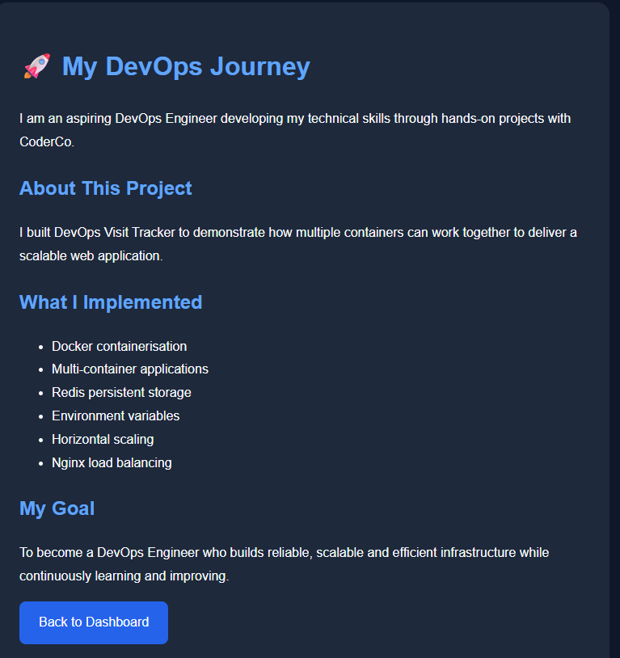
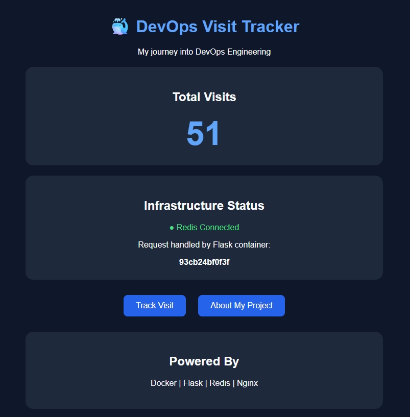

# 🐳 Docker Learning Journey


## About This Repository


This repository documents my hands-on Docker learning journey as part of the CoderCo DevOps programme. It demonstrates my understanding of containerisation, networking, persistent storage, image optimisation and load balancing through practical projects.


## Technologies Used


- Docker \& Docker Compose

- Python \& Flask

- MySQL

- Redis

- Nginx

- Docker Hub

- AWS Elastic Container Registry (ECR)

- Git \& GitHub


## Projects


### 1. Flask \& MySQL Application


A containerised Flask application connected to a MySQL database.


\*\*Key achievements:\*\*

- Built custom Docker images.

- Configured communication between containers.

- Managed multiple services using Docker Compose.

- Implemented multistage builds, reducing local image disk usage by approximately 17.5%.

- Published application images to Docker Hub and AWS ECR.


### 2. Flask \& Redis Visit Counter


A scalable multi-container web application that tracks page visits using Redis.


\*\*Key features:\*\*

- Persistent storage using Docker volumes.

- Configurable connections using environment variables.

- Three Flask application instances.

- Nginx reverse proxy and load balancing.

- Shared Redis database.

- Verified traffic distribution through container logs.


## Application Architecture


```text

&#x20;         Browser

&#x20;            |

&#x20;      Nginx :5002

&#x20;            |

&#x20;   +--------+--------+

&#x20;   |        |        |

&#x20;Flask 1  Flask 2  Flask 3

&#x20;   |        |        |

&#x20;   +--------+--------+

&#x20;            |

&#x20;          Redis

&#x20;            |

&#x20;     Persistent Volume

```


## Running the Flask \& Redis Project


Prerequisites: Docker and Docker Compose.


```bash

git clone https://github.com/subeydaosman-hub/docker-learning.git

cd docker-learning/flask-redis

docker compose up --build -d --scale web=3

```


Access the application:


- Welcome page: http://localhost:5002

- Visit counter: http://localhost:5002/count


Stop the application:


```bash

docker compose down

```


## Skills Developed


- Containerisation

- Docker image management

- Container networking

- Multi-container applications

- Persistent data management

- Environment-based configuration

- Container registries

- Horizontal scaling

- Load balancing

- Troubleshooting and debugging


## My DevOps Journey


This repository represents my practical progress towards becoming a DevOps engineer. I am continuously developing my skills by building projects, troubleshooting issues and applying DevOps concepts through hands-on learning.

## DevOps Visit Tracker – Project Showcase

A personalised dashboard demonstrating persistent storage,
horizontal scaling and Nginx load balancing.

### Application Dashboard



### About My Project




